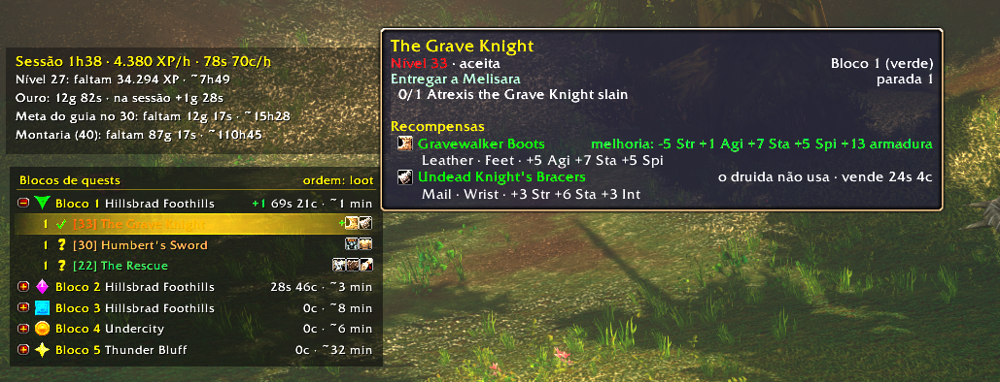
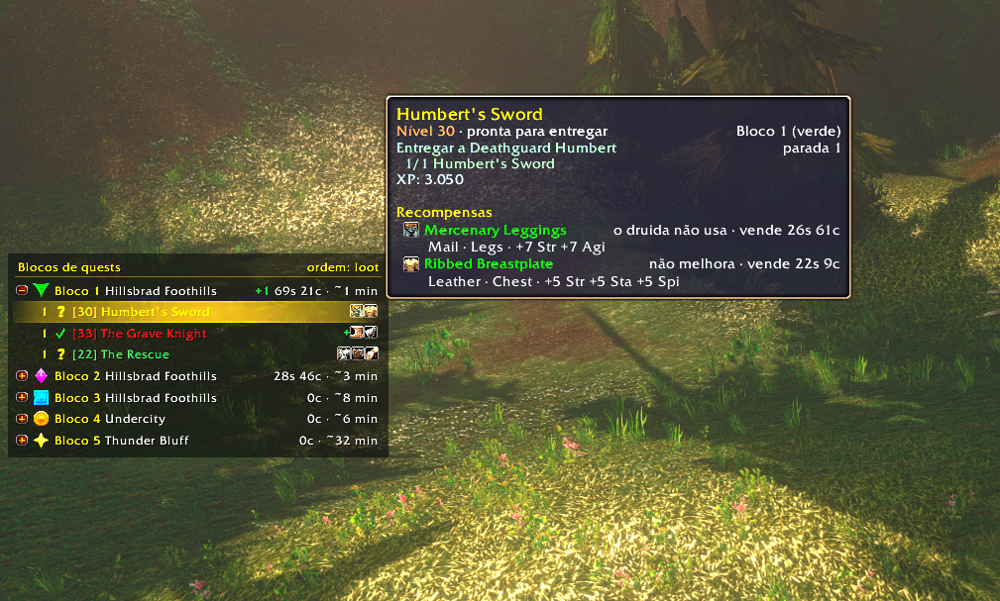

# Kit do Druida

Addon para o **WoW Forever** (Interface 16001) que junta num pacote só o que um Druida usa para upar:
- um planejador de quests em blocos, com rota numerada no mapa;
- a avaliação das recompensas contra o que você tem equipado;
- contador de buffs;
- preço do leilão e do vendedor em cada item da bolsa;
- painel da sessão;
- macros prontos;
- um conserto para digitar "?" no chat em teclado brasileiro.

> **Até o momento, a avaliação de equipamentos só serve para Druida (Feral).** O planejador de quests funciona para qualquer classe, mas a nota das recompensas usa os pesos de atributo e as armas do Druida. Com testes, dá para ampliar para as outras classes (veja [Testes fora do jogo](#testes-fora-do-jogo)).

## Imagens



*No alto, o Painel da Sessão; embaixo, a lista dos Blocos de quests em ordem de loot, com o bloco 1 aberto. A dica da quest mostra:*
- *a parada da rota e o progresso do objetivo;*
- *as botas como melhoria contra as equipadas (+1 Agi +7 Sta +5 Spi);*
- *as braçadeiras de malha, que o druida não usa, com o valor de venda.*



*Quest pronta para entregar: a rota vai direto para a entrega, com o XP e cada recompensa avaliada.*

## Funcionalidades

| Módulo | O que faz |
| --- | --- |
| **Blocos de quests** | Junta em blocos, por proximidade, as quests do seu nível, da sua classe e da sua raça, contando onde se pegam, se cumprem e se entregam. Ordena os blocos por loot por minuto ou por XP por minuto (botão "ordem" na lista). A lista é uma sanfona: um bloco aberto por vez, uma quest por linha. A rota do bloco aberto aparece numerada no mapa (M) e no minimapa. A dica de cada quest traz objetivos, paradas, XP, recompensas e a cadeia inteira de quests, com as recompensas de cada uma. |
| **Avaliação das recompensas** | Compara cada recompensa com o que está equipado no mesmo lugar e mostra a diferença ("melhoria: +2 Agi +2 Sta"). Quando não é melhoria, diz "não melhora", "o druida não usa" ou "pede nível N" e mostra o valor de venda. O valor de venda é o do vendedor, ou o do leilão pelo Auctionator quando o item não vem vinculado. |
| **Contador de Buffs** | Contagem regressiva de Mark of the Wild, Thorns, Well Fed e Well-Rested (com as pilhas). Pisca e toca um alerta quando falta 1 minuto; fica vermelho quando o buff acaba. |
| **Preço no Ícone** | Em cada item da bolsa, o preço do leilão (azul) e o do vendedor (dourado). O que rende mais, já descontados os 5% do leilão, fica aceso. |
| **Venda Certa** | Botão na janela do vendedor que vende os itens cinza e os que rendem menos no leilão do que no vendedor. A lista sai antes, com confirmação. |
| **Painel da Sessão** | XP por hora, ouro por hora e o tempo estimado até o próximo nível e até a próxima meta de ouro (montaria no 40, épica no 60). |
| **Aviso de Erva** | Mostra na tela o nome da erva que o jogo escolheu como alvo de interação e toca um som. Com o Lueur, alcança até 15 jardas. |
| **Macros do Druida** | Cria 8 macros no personagem: forma de viagem certa para o terreno, abertura em stealth, Dash, Gato, Urso, duas curas que não soltam o alvo e ressurreição. O Urso passa sozinho para Dire Bear Form quando você aprende a forma. |
| **"?" no chat** | No teclado ABNT2 sem a tecla "/ ?", o "?" sai com AltGr+W. O chat do WoW lê isso como Ctrl+W e apaga a palavra anterior; o Kit devolve a palavra e põe o "?". |

Todo quadro na tela se move (Shift + arrastar, ou destravando pelo botão do minimapa) e muda de tamanho de 50% a 200%.

## Instalação

1. Baixe o repositório (**Code → Download ZIP**).
2. Copie a pasta `KitDruida` para `World of Warcraft\_forever_\Interface\AddOns\`.
3. Feche e abra o jogo.

Addons que o Kit aproveita, todos no CurseForge:

| Addon | Para quê | É preciso? |
| --- | --- | --- |
| QuestieDB | Base de quests dos Blocos; funciona sem o Questie | Para os Blocos, sim |
| Auctionator | Preço do leilão; faça um Full Scan na casa de leilões | Não, mas sem ele não há preço de leilão |
| Lueur | Acende a erva no mundo e amplia o alcance do Aviso de Erva | Não |

## Como usar

- **Botão do gato no minimapa:** o clique abre a janela de ajustes; o botão direito destrava os quadros para mover.
- **Comandos:** `/kit` abre os ajustes; `/kit macros` cria ou atualiza os macros; `/kit mover` destrava os quadros.
- **Shift + arrastar** move qualquer quadro a qualquer hora.
- **Lista de blocos:** clique num bloco para abrir ou fechar e pare o mouse numa quest para ver a dica.
- **Macros:** depois de criados, arraste da janela `/macro` (aba do personagem) para a barra.

## Testes fora do jogo

Para mudar o código sem depender de entrar no jogo, os módulos maiores têm bancos de testes. Eles simulam a API do WoW e uma base de quests pequena e rodam com o [LuaJIT](https://luajit.org/), que lê a mesma sintaxe do Lua 5.1 do WoW:

```
luajit testes/teste_blocos.lua KitDruida/Blocos.lua
luajit testes/teste_blocos.lua KitDruida/Blocos.lua sem-dica
luajit testes/teste_macros.lua KitDruida/Macros.lua
luajit testes/teste_chat.lua KitDruida/Chat.lua
```

**Por esses testes a avaliação de equipamentos pode chegar às outras classes.** São três passos:
1. Acrescentar os pesos de atributo de cada classe (tabela `PESOS`, no começo de `Blocos.lua`).
2. Acrescentar as armas e armaduras que ela usa (`DRUIDA_ARMADURA` e `DRUIDA_ARMA`).
3. Pôr os casos novos no banco de testes.

## Limitações e decisões

- **Equipamento só para Druida (Feral)** por enquanto, como dito no começo.
- **Recompensa fixa ou de escolher:** a base de quests não separa uma da outra. A quest vale a melhor recompensa, porque quase sempre se escolhe uma.
- **Macros:** não vão sozinhos para a barra, para não sobrescrever os seus botões.
- **Leilão:** o preço depende de um Full Scan do Auctionator.
- **Marcadores do mapa:** são quadros do próprio Kit, sem a HereBeDragons-Pins que muitos addons usam. A Pins escreve dentro do mapa da Blizzard, e com ela carregada a área azul das quests sumia no Forever. O Kit usa só o núcleo da HereBeDragons, para converter coordenadas.
- **Combate:** o cliente do Forever esconde parte dos valores dos addons em combate. Toda leitura passa por proteção, e o que depende delas espera o combate acabar.

## Créditos e licenças

O código do Kit está sob a licença MIT (arquivo [`LICENSE`](LICENSE)). As bibliotecas em `KitDruida/Libs` são dos seus autores e seguem os termos deles:

- **LibStub**: domínio público.
- **CallbackHandler-1.0**: Ace3 Development Team, sob a licença do Ace3.
- **HereBeDragons-2.0**, só o núcleo: Nevcairiel, [github.com/Nevcairiel/HereBeDragons](https://github.com/Nevcairiel/HereBeDragons).

## In English

Kit do Druida is a World of Warcraft: Forever addon (interface in Portuguese) for leveling a Druid. It bundles:
- a proximity-based quest block planner with numbered routes on the map and minimap;
- reward evaluation against your equipped gear;
- buff timers;
- auction and vendor prices on bag icons;
- a session panel;
- ready-made Druid macros;
- a fix for typing "?" with AltGr+W on Brazilian keyboards.

**For now, gear evaluation only works for Druids (Feral); the planner works for any class.** With more tests, other classes can be added: the offline test harnesses in `testes/` run with LuaJIT.
